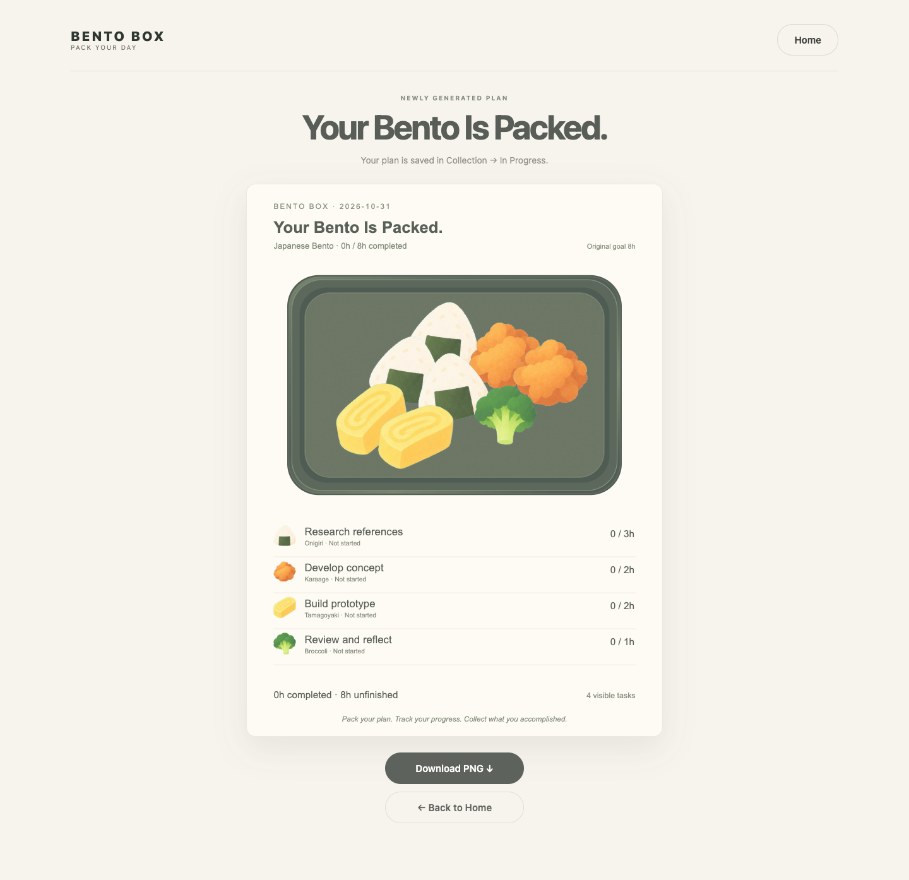

# BENTO BOX — Pack Your Day

**An Interactive Time-Planning Experience**

BENTO BOX is a playful web-based time planner that turns daily tasks into a personalised bento box. Instead of organising time through traditional lists or calendars, users plan their day by selecting food items, with each portion representing one hour of work.

The goal is to make time planning more visual, engaging, and enjoyable.

**[Try BENTO BOX Online](https://13482278110-design.github.io/bento-box/)**

## Final Prototype Preview

## 01. Project Overview

Traditional time-planning tools often focus on schedules, deadlines, and productivity. BENTO BOX explores a different approach: what if planning a day felt like preparing a meal?

Users choose a bento style, decide how many hours they want to plan, and fill their box with food representing different tasks.

The completed bento becomes a visual representation of their daily plan.

**Core Concept: One food portion = One hour of work.**

**Intended Users:** Students and people who want a more playful and visual way to organise their daily tasks and manage their time.

The main interaction connects **user input → visual response → progress feedback**: users assign hours to tasks, see those hours become food portions, and then update each task as work is completed.

## 02. Core Features

### Customise Your Bento

Choose from six visual themes:

- Japanese Bento
- Korean Bento
- Chinese Dim Sum
- Pudding Boat
- Bread & Dessert
- Western Brunch

Each theme has its own food selection and arrangement style.

### Plan Your Time

Select a time capacity of 4, 8, 12, or 24 hours.

Add tasks by choosing food items, entering task names, and adjusting their duration. The number of food portions reflects the time assigned to each task.

### Generate Your Bento

Transform the planned tasks into a personalised bento card with a top-down food arrangement.

Users can also export their bento as a PNG image.

### Manage Your Tasks

Save bentos in **My Collection**, organised into two categories:

- **In Progress:** Save a plan, reopen it later, continue editing, and track partial completion hour by hour with `+` and `−` controls.
- **Completed:** View finished bentos and their task records.

Users can also rename or delete saved bentos.

Saving an In Progress Bento does not finish it. A Bento moves to Completed only when the user explicitly selects **Finish Bento**.

### Adjust Your Plan

Initial planning follows the selected time capacity.

After a bento has been created, users can extend its capacity by up to four additional hours while editing an In Progress bento.

This allows plans to adapt when extra time or new tasks are needed.

## 03. How to Use

1. **Choose a Style** — Select your preferred bento theme.
2. **Set Your Capacity** — Choose how many hours you want to plan.
3. **Add Tasks** — Select foods, name your tasks, and assign their durations.
4. **Generate Your Bento** — Create a visual card representing your plan.
5. **Track Your Progress** — Open the saved Bento in My Collection and use the `+` and `−` controls to record completed hours.
6. **Finish Your Bento** — Select **Finish Bento** when the plan is ready to become a read-only Completed record.

## 04. Technology

BENTO BOX is developed as an interactive browser-based experience using:

- HTML
- CSS
- JavaScript
- Browser localStorage for saving bento and task information
- GitHub for version control
- GitHub Pages for online deployment

The project can run directly in a modern web browser without installing additional software.

### Run Locally

Download or clone this repository and open `index.html` in a modern browser. No dependencies or installation steps are required.

`index.html` redirects to the final application file, `BENTO_BOX_V8.html`. This direct-file workflow was verified in Chrome during the final repository check.

Keep the project assets in their original relative locations to ensure that images load correctly.

## 05. AI-Assisted Development

AI tools were used throughout the design and development process.

**ChatGPT** helped me explore interaction ideas, organise user flows, clarify functional requirements, and reflect on design decisions.

**Codex** supported the implementation and refinement of HTML, CSS, and JavaScript, including interactive features, task management, and interface adjustments.

**AI-assisted image generation** was used to explore visual styles and develop food illustrations and container assets. I selected and refined these assets to maintain a consistent visual direction.

My role focused on defining the concept, making design decisions, reviewing generated results, identifying problems, and iterating on the experience.

AI made it possible to move from a design concept to a working interactive prototype while continuing to learn about programming through the development process.

## 06. Current Status & Limitations

BENTO BOX is a course prototype rather than a fully released product.

User testing was conducted on October 30, 2026. The findings informed the V8 onboarding, navigation, partial-progress tracking, information hierarchy, and interaction refinements documented in [PROCESS.md](PROCESS.md).

- Saved data uses browser localStorage, so records are specific to the browser and device in which they were created rather than synchronised across devices.
- Some interactions and visual arrangements may still need refinement.

## 07. Development Process

The project has evolved through multiple iterations, including visual exploration, food arrangement experiments, task management, navigation improvements, and interaction refinement.

For a detailed record of the design process, technical challenges, AI usage, and testing, see:

**[PROCESS.md](PROCESS.md)**

---

